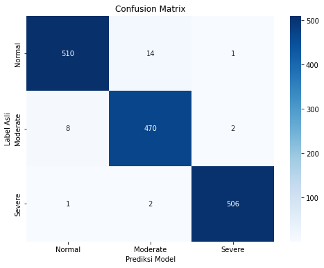
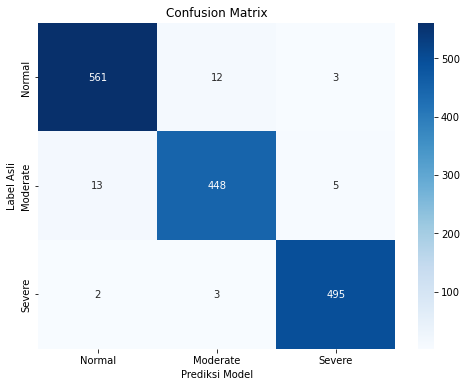

# 🧠 Mental Health Check: Indonesian Twitter Depression Detection


## 📌 Overview

An end-to-end AI-powered web application designed to classify depression risk levels (**Normal**, **Moderate**, **Severe**) based on Indonesian social media text (Twitter/X). This project addresses the linguistic challenges of Indonesian slang and implicit emotional context to provide an early mental health screening research prototype.

## ⚙️ Architecture & Methodology

- **Text Preprocessing (`src/preprocessing.py` & `src/slang_dict.json`):** Custom slang normalization and whitelist-based stopword removal to retain crucial negation words and implicit emotional markers.
- **Feature Selection:** TF-IDF (Term Frequency-Inverse Document Frequency) vocabulary filtration.
- **Deep Learning Model (TF-IDF + GRU):** Gated Recurrent Unit (GRU) architecture with Spatial Dropout and L2 Regularization. On the thesis evaluation dataset, **TF-IDF + GRU** achieved **98.67% accuracy** and **98.67% macro F1-score**, outperforming the Stacked LSTM baseline in both accuracy and training efficiency.
- **Post-Processing (Positive Guard):** A transparent heuristic layer in Flask (`app/main.py`) to reduce false positives on casual or resilient positive expressions (e.g., *"tetap semangat"*). When triggered, the predicted label is adjusted to **Normal** with an explicit **Adjusted by Positive Guard** indicator while still displaying the model's raw probability distribution.

## 📊 Key Results

| Architecture | Accuracy | F1-Score (Macro) | Training Time |
| :--- | :--- | :--- | :--- |
| **TF-IDF + GRU (Proposed)** | **98.67%** | **98.67%** | **~33.9 mins** |
| TF-IDF + Stacked LSTM | 97.88% | 97.87% | ~49.4 mins |

*The TF-IDF + GRU model operates ~31.4% faster than the Stacked LSTM while maintaining strong precision on detecting Suicidal Ideation.*

### Evaluation Visuals





## 📁 Project Structure

```text
deteksi_depresi/
├── app/
│   ├── __init__.py
│   ├── main.py                 # Flask inference app
│   ├── static/
│   │   └── style.css
│   └── templates/
│       └── index.html
├── src/
│   ├── __init__.py
│   ├── preprocessing.py        # Indonesian text preprocessing pipeline
│   └── slang_dict.json         # External slang normalization dictionary
├── notebooks/                  # Data crawling, cleaning, and model training notebooks
├── tools/
│   └── label_tool/             # Internal Flask annotation helper
├── tests/
│   └── test_preprocessing.py   # Basic preprocessing unit tests (pytest)
├── data/
│   ├── raw/
│   ├── processed/
│   └── queries/
├── models/                     # Pre-trained model & tokenizer artifacts
├── reports/
│   └── figures/                # Evaluation plots and confusion matrices
├── requirements.txt
└── README.md
```

## 🚀 How to Run Locally

1. Clone this repository:

   ```bash
   git clone https://github.com/Lax28/deteksi-depresi.git
   cd deteksi-depresi
   ```

2. Install dependencies:

   ```bash
   pip install -r requirements.txt
   ```

3. Place the pre-trained artifacts (`depression_model_multiclass.h5`, `tokenizer.pkl`, and `tfidf_vectorizer.pkl`) inside the `models/` directory (excluded from Git due to file size).

4. Run the Flask application from the project root:

   ```bash
   python app/main.py
   ```
   *(or `python -m app.main`)*

5. Open your browser and navigate to `http://127.0.0.1:5000/`.

6. *(Optional)* Run preprocessing unit tests:

   ```bash
   pytest
   ```

## ⚠️ Limitations & Ethical Disclaimer

- **Not a Medical Diagnosis:** This application is an academic research prototype and **is NOT a substitute for professional medical or psychological diagnosis**.
- **Scope & Bias:** The model was trained on Indonesian Twitter/X text and may be sensitive to out-of-domain phrasing, sarcasm, or unseen slang.
- **Crisis Support:** If you or someone you know is experiencing severe emotional distress or thoughts of self-harm, please seek immediate help from a licensed psychologist, psychiatrist, or local emergency services.
